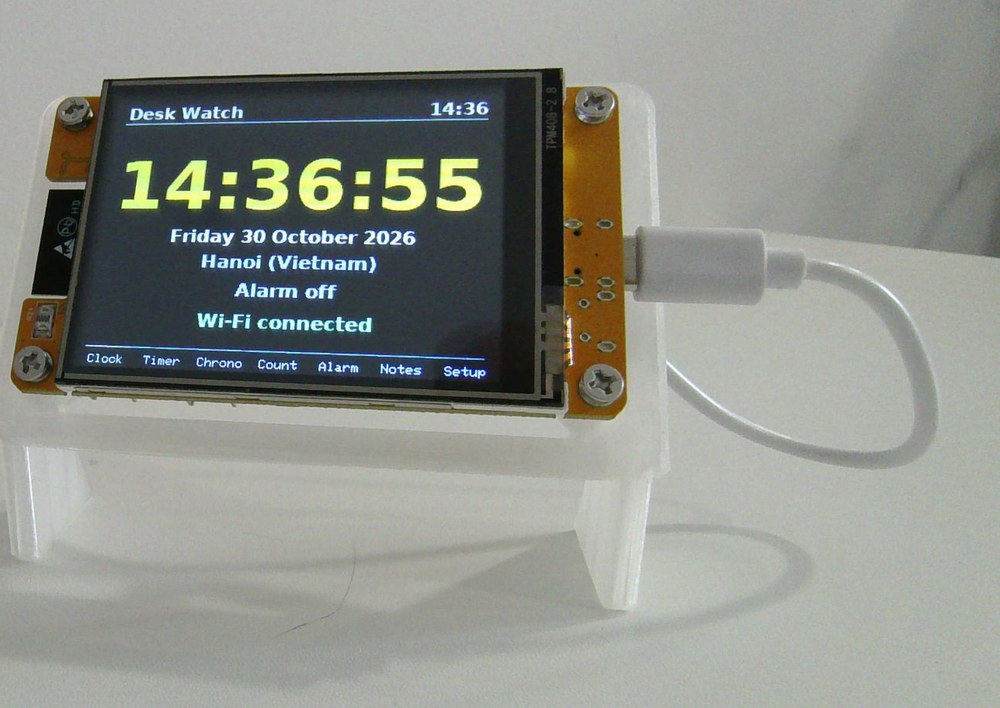
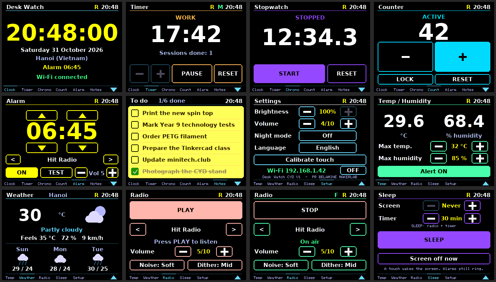
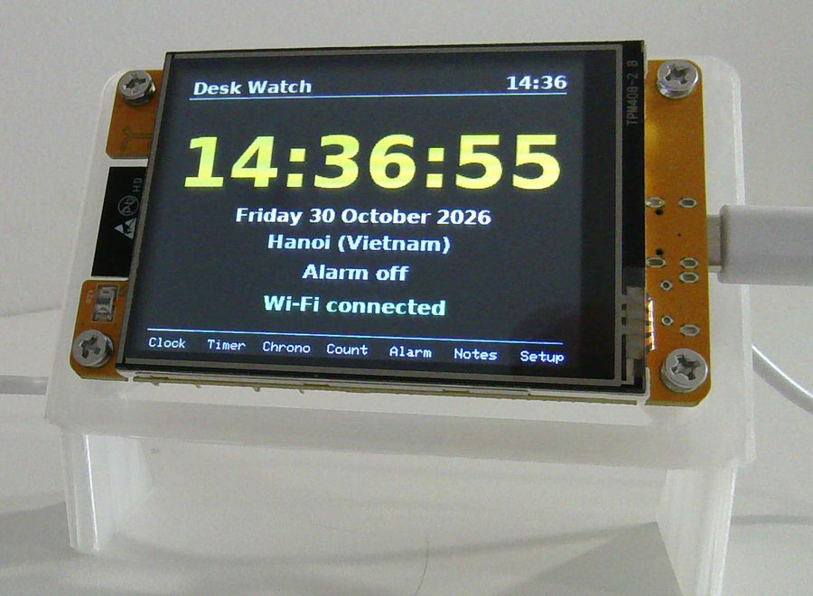
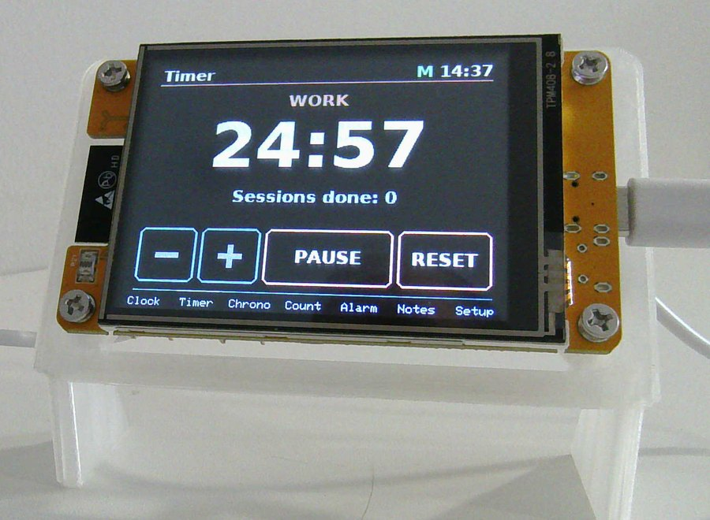
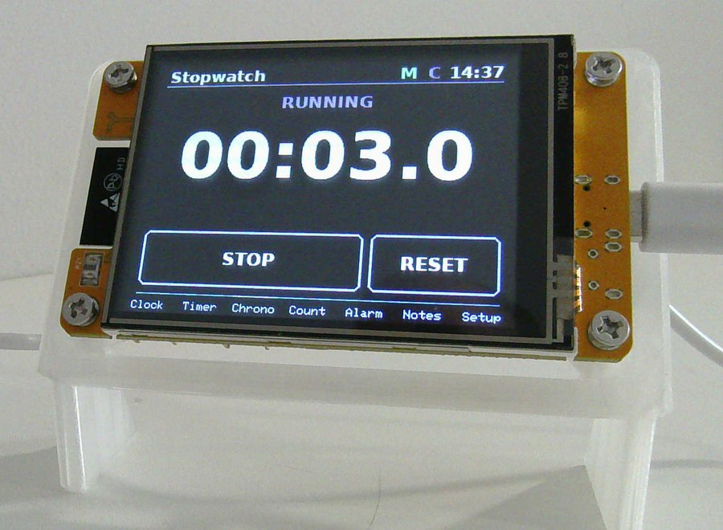
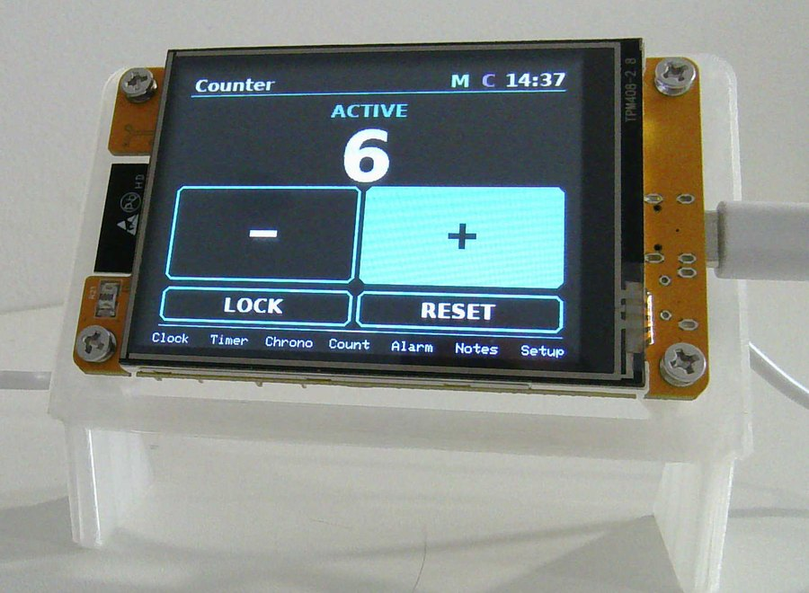
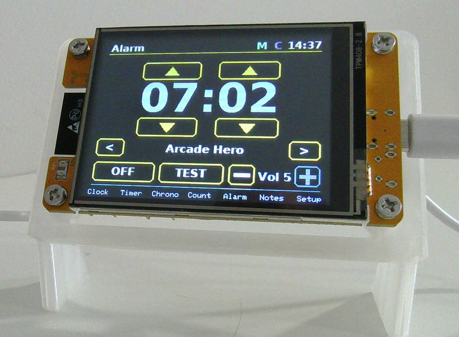
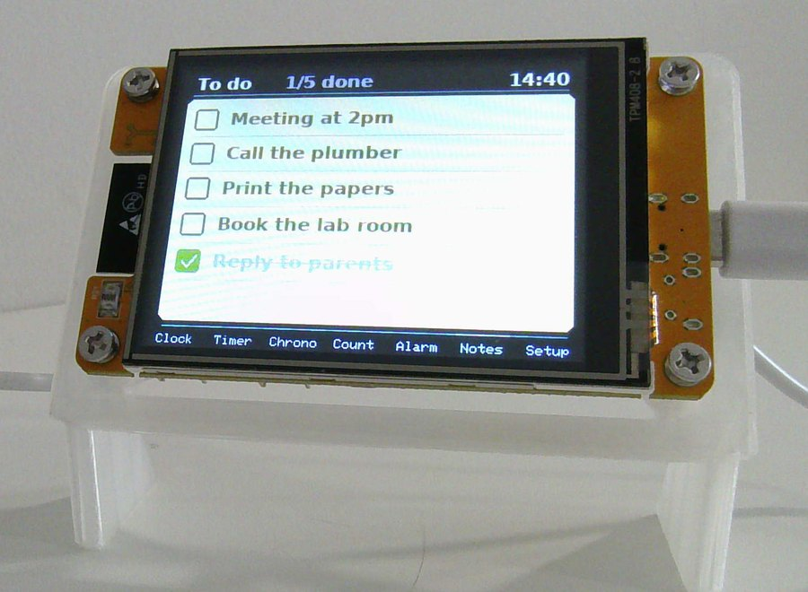
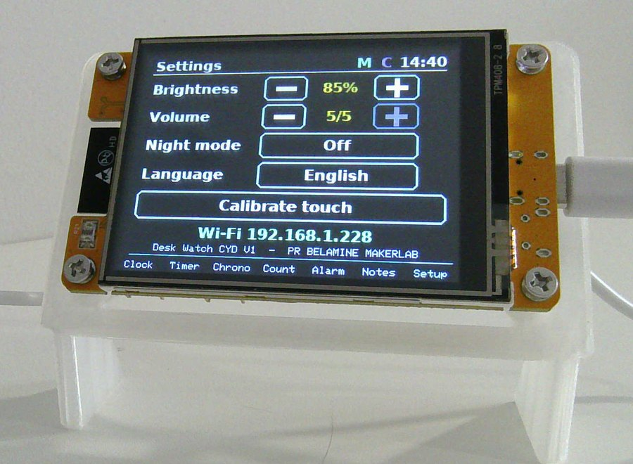

# Desk Watch CYD V1 (edition 1.27)

A desk companion for the **ESP32-2432S028R "Cheap Yellow Display" (CYD, 2.8" touchscreen)**.
It is the touchscreen port of the *Desk Watch JOY STUDENT edition* (Arduino UNO + joystick) by Pr. BELAMINE MakerLab.

*Screens rendered on a PC from the real drawing code.*

**Install in one click (no code):** open the install page in Chrome or Edge, plug the board in over USB and click *Install*: https://minitech.club/cyd-desk-watch/desk-watch/ (edition 1.27 with the web radio: https://minitech.club/cyd-desk-watch/desk-watch/1.27/index.html)

**3D-printed stand:** [CYD 2.8 Display Stand - Minimalist Open Design on MakerWorld](https://makerworld.com/en/models/3513895-cyd-2-8-display-stand-minimalist-open-design) (the stand shown in the photos).

## Photos of the real device

| Clock | Timer | Stopwatch |
| --- | --- | --- |
|  |  |  |
| **Counter** | **Alarm** | **Notes (Post-it)** |
|  |  |  |

## What it does

| Page | Features |
| --- | --- |
| **Clock** | Large time (synchronised over Wi-Fi), date, alarm status |
| **Timer** | Pomodoro: work 1-60 min in 1 min steps, then 65 min to 4 h in 5 min steps; 5 min breaks, 15 min long break every 4th session; keeps running on other pages |
| **Chrono** | Stopwatch with tenths of a second, start / stop / reset; keeps running on other pages |
| **Count** | Tally counter 0-9999, lock button, reset with confirmation, value kept after power loss |
| **Alarm** | Set the time with the arrows, 4 original melodies **or one of the 3 web radios** with preview, volume (10 levels + off, level 1 is very quiet; the radio has its own volume), snooze 5 min, stops after 2 min and rings again. If the radio is not playing 20 s after the alarm starts (no Wi-Fi, stream down), the Aurora melody takes over; the volume buttons change the sound being previewed at once |
| **Sleep** | Screen standby after 1, 2, 5, 10 or 30 min without touch (a touch wakes it, alarms and timer ends wake it too) and a radio sleep timer (10 to 90 min): **SLEEP** starts the radio, fades it out over the last 30 s, stops it and turns the screen off. Small letter **Z** while the timer runs |
| **Radio** | Web radio on the speaker: 3 radios of your choice (Hit Radio, France Info and FIP at the start; change them on `http://cyd.local/radios`), arrows to change radio, PLAY / STOP, own volume (10 levels). Reached with the down arrow (second row); the radio keeps playing on other pages (small letter **F**) |
| **Notes** | Digital Post-it: up to 18 tasks (3 screens of 6, use the arrows to change screen), tick them on the screen, edit them from your phone at `http://cyd.local` |
| **Setup** | Brightness, volume (off + 10 levels, starting very quiet), night mode (screen dims to 8 % and timer beeps are muted between 22:00 and 06:00), touch calibration |

Small letters at the top right show what runs in the background: **R** alarm armed, **M** timer running, **C** stopwatch running, **F** web radio on, **Z** sleep timer running.
Swipe left/right or tap the bottom bar to change page. Hold on an empty area for 3 s (or touch the screen while it boots) to recalibrate the touch.

## Install without Arduino (web installer)

The `flasher/` folder is a ready-to-host page (ESP Web Tools): plug the board in over USB, open the page in Chrome or Edge, click **Install**, then enter your Wi-Fi name and password when the page asks.
The Wi-Fi settings travel over the USB cable (Improv Wi-Fi Serial) and are stored in the board's flash, never in the firmware file.
Host the folder on any HTTPS site (for example minitech.club). `flasher/desk-watch/<edition>/firmware.bin` is built by `tools/build_firmware.sh` (PlatformIO, "Huge APP" partition, the edition number comes from `Settings.h`). `flasher/desk-watch/firmware.bin` is the original version 1.0, kept as it was published (see the `v1.0` tag for its source).

## Install from source

1. **Arduino IDE 2.x** with the **esp32 by Espressif** board package (**3.2.0** is the tested version; the radio sounded duller with 3.3.x) and these libraries (Library Manager): **TFT_eSPI**, **XPT2046_Touchscreen** and **ESP8266Audio** (by Earle F. Philhower, III; web radio). With the core 3.x and ESP8266Audio 2.4.1, the file `AudioOutputPDM.cpp` of that library does not compile and is not used here: see "Radio" below.
2. Replace `Documents/Arduino/libraries/TFT_eSPI/User_Setup.h` with `User_Setup_CYD.h` from this repository (rename it to `User_Setup.h`).
   If you already use the CYD with TFT_eSPI, your existing setup works as long as it enables `SMOOTH_FONT`.
3. Either copy `Desk_Watch_CYD_V1/Secrets.example.h` to `Desk_Watch_CYD_V1/Secrets.h` and enter your Wi-Fi name and password, or skip this step and set the Wi-Fi later from the web installer page (Improv, over USB).
4. Language (English/French) and time zone (country + city, default Hanoi) are chosen after the first start from `http://cyd.local/location`; the language can also be switched on the Settings page of the board.
5. Open `Desk_Watch_CYD_V1.ino`, choose **ESP32 Dev Module**, the partition scheme **Huge APP (3MB No OTA/1MB SPIFFS)** (the radio makes the firmware larger than the default 1.3 MB), and upload. No LittleFS data upload is needed.

## Web radio

The radio plays plain HTTP streams (no TLS, to save memory) through the 8-bit DAC of the ESP32 on GPIO26, the pin that feeds the speaker amplifier.
The sound is oversampled to about 190 kHz with noise shaping, dither and a 150 Hz - 9 kHz band-pass filter, which makes the 8-bit output much cleaner. The decoder runs in its own task, so the screen and the touch never wait for it.
The watch holds **3 radios**. Choose them on `http://cyd.local/radios` (name + stream address for each; a **Test** button plays the address in your browser; **Factory radios** brings back the list of `Radios.h`). They are saved on the watch and also appear in the alarm sound list. The address must be a direct MP3 stream starting with `http://` (not https, not AAC, not a .m3u/.pls playlist). `Radios.h` only holds the factory list.

Things to know:
- While the radio plays, the weather is not refreshed (memory) and timer or temperature beeps are silent: the banner still shows. The alarm always takes over the speaker.
- The Settings page has a **Wi-Fi OFF / ON** button next to the IP address (the Wi-Fi comes back at the next start; with a radio alarm it comes back by itself 2 minutes before the alarm).
- The radio needs Wi-Fi; the free memory is tight (the screen buffer uses 75 KB), so very large streams may not fit.
- If `AudioOutputPDM.cpp` of ESP8266Audio 2.4.1 stops the compilation with `data_fmt`, it is not needed: delete that file from the library's `src` folder (the firmware uses its own DAC output, `Radio.cpp`).
- Sound quality depends on the Arduino-ESP32 core version used to compile: the web installer firmware is built with **core 3.2.0** (pinned in `tools/pio/platformio.ini`). If you compile it yourself, stay on 3.2.0 for the same sound.

## The watch's web page: `http://cyd.local`

When the board is on your Wi-Fi, open `http://cyd.local` (or the IP address shown on the Notes page) from a phone or computer on the same network. The page adapts to phones, tablets and computers and has three tabs at the bottom:
- **To-Do**: the Digital Post-it.
- **Location**: search your town (the search uses the free Open-Meteo geocoding service from your phone or computer, so that device needs Internet): it sets the town of the Weather page and, when it recognises the time zone, the clock too. Language and time zone can also be chosen by hand.
- **Radios**: the 3 web radios (see Web radio above).

### Digital Post-it
Add, tick, delete tasks or clear the finished ones; the screen updates immediately, and ticking on the screen updates the page.
The page has **no password**: anyone on your local network can edit the list. Do not expose the board to the internet.
The Location tab (`http://cyd.local/location`) lists every country and city (IANA tz database, bundled as `Desk_Watch_CYD_V1/TimeZones.h`; regenerate it with `python3 tools/make_timezones.py`). The Post-it, settings and installer pages are bilingual (English/French).

Tasks are limited to 60 characters; the font covers French and other Latin accents (characters outside it show as `?`).

## Tests

`python3 tools/test.py` (needs g++) runs the host tests of the logic: Pomodoro, stopwatch, counter, alarm and snooze, touch calibration, navigation, formatting, and the task list.
The drawing, touch, sound and web code runs only on the board.

`python3 tools/make_fonts.py` regenerates the embedded fonts (needs Pillow and DejaVu Sans Bold).

## Credits

Code and design: Pr. BELAMINE MakerLab. The Post-it idea was inspired by Mechmaestro's Digital Post-it (no code reused).
See `THIRD_PARTY_NOTICES.txt`.

**Licences.** The source code written for this project is MIT (`LICENSE`). The web radio uses ESP8266Audio (GPL-3.0) and its libmad MP3 decoder (GPL-2.0 or later). A ready-made firmware that contains them, such as the `firmware.bin` of edition 1.27 in `flasher/`, is therefore distributed under the **GNU GPL v3** (`licenses/GPL-3.0.txt`), and this repository is its corresponding source (build it with `tools/build_firmware.sh`). Version 1.0 (no radio) is MIT only.

## Temperature and humidity (optional DHT22)

Press the down arrow at the right of the footer to open the second row of apps: **Temp** (temperature and humidity), **Weather**, **Radio**, **Sleep** and **Setup**. The up arrow goes back to the first row; swiping changes app inside the current row.
Wire a DHT22 to the CN1 connector: 3V3 to VCC, GND to GND, IO27 to DATA (IO22 stays unused). Without a sensor the page simply shows "No sensor".
The two thresholds (maximum temperature, maximum humidity) and the alert on/off switch are set on the page and saved. When a threshold is crossed the speaker beeps three times, once per crossing (with a 1 degree / 3 % hysteresis).

## Weather page

The **Weather** app (second row) shows the current conditions and the next three days for your town, downloaded from [Open-Meteo](https://open-meteo.com) every 20 minutes (free, no account, no API key; it only needs the Wi-Fi). Choose your town on `http://cyd.local/location` (default Hanoi; `Settings.h` only holds the starting town). Weather data by Open-Meteo.com, CC BY 4.0, free for non-commercial use.
